# Layout & Home-Row Mod Analysis

## 1. Layer Architecture

```
Layer 3 ─ Navigation/Media (TT(3) toggle)
  ├── Arrow keys (HJKL positions), Home/End/PgUp/PgDn
  ├── One-shot modifiers (OSM) on left home-row
  └── Media controls on right hand

Layer 2 ─ Symbols (right thumb: LT(2, KC_SPACE))
  ├── Left hand: ! @ # $ % and DUAL_FUNC_1/2/3 (symbols with mod-tap)
  ├── Right home-row: HRM_J, HRM_K, HRM_L, HRM_SCLN → modifiers
  └── Right hand: } ] ) &

Layer 1 ─ Numbers (left thumb: LT(1, KC_ENTER))
  ├── Left home-row: HRM_A, HRM_S, HRM_D, HRM_F → modifiers
  ├── Right hand: numpad (7,8,9 / 4,5,6 / 1,2,3 / 0) with MT() mods
  └── Right home-row: standard MT(MOD_*, KC_number) keys

Layer 0 ─ Base (QWERTY Alpha)
  ├── Home-row: HRM_A, HRM_S, HRM_D, HRM_F, KC_G, KC_H, HRM_J, HRM_K, HRM_L, HRM_SCLN
  ├── Left thumb cluster:  LT(1, KC_ENTER), MT(MOD_LGUI, KC_TAB), KC_LEFT_CTRL
  └── Right thumb cluster: KC_LEFT_ALT, DUAL_FUNC_0, LT(2, KC_SPACE)
```

## 2. Core Architectural Philosophy & Mechanics

### The Problem Standard Home-Row Mods Face
Standard QMK Home-Row Mods (`MT(MOD, KC)`) are notorious for misfires during fast typing: fast rolls or slight overlaps cause keys to resolve as modifiers (e.g., accidental `Cmd+S` or `Ctrl+Q`).

### Your Design Principle
1. **Layer 0 (Base / Alphas)**:
   - Home-row keys (`A, S, D, F` and `J, K, L, ;`) behave strictly as **regular letters**.
   - If held alone past `AUTO_SHIFT_TIMEOUT` (180ms), they auto-shift to uppercase (`A, S, D, F...`).
   - They **never** become modifiers on Layer 0 on their own.
2. **Thumb-Gated Modifiers (Layer 1 & Layer 2)**:
   - Modifiers can **only** be activated in conjunction with a thumb layer key:
     - Left Thumb: `LT(1, KC_ENTER)` (Switches to Layer 1: Numbers on right hand + HRM on left).
     - Right Thumb: `LT(2, KC_SPACE)` (Switches to Layer 2: Symbols on left hand + HRM on right).
3. **Cross-Hand Shortcut Design**:
   - Shortcuts are designed to be activated with the **opposite hand's modifiers**:
     - Right Thumb + Right Pinky (`HRM_SCLN` = Ctrl) $\rightarrow$ Left Hand `C` (`Ctrl+C`).
     - Left Thumb + Left Pinky (`HRM_A` = Ctrl) $\rightarrow$ Right Hand key.
4. **Flexible Sequencing ("Home-Row First" vs. "Thumb First")**:
   - **Thumb First**: Hold Thumb $\rightarrow$ press home-row key $\rightarrow$ immediate modifier.
   - **Home-Row First**: Press home-row key $\rightarrow$ realize you need a modifier $\rightarrow$ press Thumb within the tapping/auto-shift window $\rightarrow$ transitions pending key into a modifier.

---

## 3. Thumb Keys & Layer Transitions

Two thumb keys drive the entire HRM system:

| Thumb Key | Position | QMK Code | Tap | Hold |
|-----------|----------|----------|-----|------|
| Left thumb | bottom-left cluster | `LT(1, KC_ENTER)` | Enter | Activate Layer 1 |
| Right thumb | bottom-right cluster | `LT(2, KC_SPACE)` | Space | Activate Layer 2 |

### How Thumb Tracking Works

```c
// Track physical thumb state
if (keycode >= QK_LAYER_TAP && keycode <= QK_LAYER_TAP_MAX) {
    uint8_t layer = QK_LAYER_TAP_GET_LAYER(keycode);
    if (layer == 1) thumb_1_pressed = record->event.pressed;
    else if (layer == 2) thumb_2_pressed = record->event.pressed;
}
```

> [!IMPORTANT]
> `thumb_1_pressed` and `thumb_2_pressed` track the **physical press state**, separate from `layer_state`. This is critical because QMK's `LT()` processing may delay the actual layer change until tapping term expires, but the physical thumb tracking updates immediately on the initial press event.

---

## 4. Home-Row Mod State Machine

Each of the 9 HRM keys tracks its own state:

```mermaid
stateDiagram-v2
    [*] --> IDLE
    IDLE --> PENDING: Press HRM key on L0 (start 180ms timer)
    IDLE --> MODIFIER_ACTIVE: Press HRM key while Thumb held (immediate)
    
    PENDING --> TAP_FIRED: 180ms timer expires & NO thumb held (register Shift+Letter)
    PENDING --> MODIFIER_ACTIVE: Thumb pressed within 180ms (register Mod)
    PENDING --> SETTLED_TAP: Another regular key pressed (eager flush to prevent inversion)
    PENDING --> IDLE: Released before 180ms & NO other key (tap letter)
    
    SETTLED_TAP --> IDLE: Physical release (already tapped; no action)
    TAP_FIRED --> IDLE: Physical release (unregister Shift+Letter)
    MODIFIER_ACTIVE --> IDLE: Physical release (unregister Mod; no letter output)
```



### HRM Key Assignments

| Key | Letter | Modifier | Appears on Layers |
|-----|--------|----------|-------------------|
| HRM_A | KC_A | KC_LCTL (Ctrl) | 0, 1 |
| HRM_S | KC_S | KC_LALT (Option) | 0, 1 |
| HRM_D | KC_D | KC_LGUI (Cmd) | 0, 1 |
| HRM_F | KC_F | KC_LSFT (Shift) | 0, 1 |
| HRM_H | KC_H | **0 (none)** | 0 only |
| HRM_J | KC_J | KC_LSFT (Shift) | 0, 2 |
| HRM_K | KC_K | KC_LGUI (Cmd) | 0, 2 |
| HRM_L | KC_L | KC_LALT (Option) | 0, 2 |
| HRM_SCLN | KC_SCLN | KC_LCTL (Ctrl) | 0, 2 |

---

## 5. Identified Bugs & Solutions

### Bug 1: Key Inversion / Out-of-Order Rolling (Fast Typing) [FIXED & VERIFIED]
* **Scenario**: Typing the word **"from"** quickly.
* **Problem**: `HRM_F` is pressed and enters `PENDING` (waiting 180ms). 30ms later, `KC_R` is pressed. Because `KC_R` is a regular key, it bypassed the HRM queue and emitted `R` immediately. On release of `F`, `tap_code(KC_F)` ran, outputting **"rf" instead of "fr"**.
* **Solution**:
  1. `hrm_flush_pending_keys()` eagerly flushes all pending HRM keys in chronological order of press as taps (`tap_code`) and marks them `HRM_STATE_SETTLED_TAP` before processing any incoming regular key.
  2. `hrm_handle_release()` includes inverted release roll protection: if key `D` is released while an older pending key `S` is still in the queue, `S` is flushed first, guaranteeing press order ("sd").
* **Verified by Tests**: `Hrm.fix_bug1_fast_roll_key_inversion` and `Hrm.fix_bug1_inverted_release_roll`.

### Bug 2: "Thumb First" Modifier Lag & Missing Mouse-Click Chords [FIXED & VERIFIED]
* **Scenario**: Holding Left Thumb, then pressing `D` (Cmd) to do `Cmd + Click` or `Cmd + C`.
* **Problem**: In original code, `hrm_activate_modifiers()` ran before `hrm_handle_press()`. When `HRM_D` was pressed while Thumb was held, it was put into `PENDING` with a 180ms timer. A mouse click or quick tap within 180ms saw no modifier active.
* **Solution**: In `hrm_handle_press()`, if a thumb key is already held (`thumb_1_pressed` or `thumb_2_pressed`) or the active layer is Layer 1 or 2, the modifier registers immediately at 0ms and transitions directly to `HRM_STATE_MODIFIER_ACTIVE` without starting any timer.
* **Verified by Tests**: `Hrm.modifier_chord_two_hrm_keys`, `Hrm.cross_hand_shortcut_ctrl_c_option_a`.

### Bug 3: Phantom `Enter` / `Space` on Thumb Key Release [VERIFIED]
* **Scenario**: Press `D` (Cmd), press Left Thumb (`LT(1, KC_ENTER)`), release `D`, release Thumb within 200ms.
* **Resolution**: Under `PERMISSIVE_HOLD` (configured in `config.h`), tapping another key while the `LT()` key is pressed resolves the thumb hold immediately, avoiding phantom taps.
* **Verified by Tests**: `Hrm.home_row_first_modifier_activation`.

### Bug 4: 180ms Lockout on "Home-Row First" [VERIFIED]
* **Scenario**: Press `A`, hold past 180ms before hitting the Thumb key.
* **Behavior**: At 180ms, auto-shift fires uppercase `A` (`TAP_FIRED`). The key can no longer transition to a modifier. If the thumb key is subsequently pressed while `A` is still held, `hrm_activate_modifiers()` checks `state->state == HRM_STATE_PENDING` and ignores keys in `TAP_FIRED` state, preventing accidental modifier activation.
* **Verified by Tests**: `Hrm.bug4_autoshift_prevents_modifier`.

### Bug 5: Thumb Released Before HRM Key (Option A vs. Option B) [SUPPORTED & VERIFIED]
* **Design Decision**: **Option A** is selected and implemented. The modifier remains active as long as the HRM key is physically held down, even if the thumb key is released and the keyboard returns to Layer 0. Upon release of the HRM key, the modifier unregisters cleanly and no letter is emitted.
* **Benefit**: Enables cross-hand shortcuts like:
  1. Hold Right Thumb (`LT(2, KC_SPACE)`) $\rightarrow$ Layer 2.
  2. Press Right Pinky (`HRM_SCLN`) $\rightarrow$ registers `Ctrl` immediately.
  3. Release Right Thumb $\rightarrow$ keyboard returns to Layer 0 while `Ctrl` remains held.
  4. Press Left Hand `C` $\rightarrow$ host receives `Ctrl + C`.
  5. Release Left Hand `C`.
  6. Release Right Pinky $\rightarrow$ `Ctrl` unregisters cleanly, no semicolon (`;`) emitted.
* **Verified by Tests**: `Hrm.cross_hand_shortcut_ctrl_c_option_a`, `Hrm.cross_hand_shortcut_thumb_held_throughout`.

### Bug 6: HRM_H With Thumb Stuck State [FIXED & VERIFIED]
* **Problem**: `HRM_H` has `modifier = 0`. If held past 180ms while thumb was pressed, it previously skipped modifier activation and remained stuck in `HRM_STATE_PENDING` with an invalid token.
* **Solution**: In `hrm_autoshift_callback()`, if `thumb_1_pressed || thumb_2_pressed || layer == 1 || layer == 2`, the state machine checks `if (state->modifier != 0)`. If `state->modifier == 0` (as for `HRM_H`), it cleanly falls back to auto-shift (`Shift + H`, transitioning to `HRM_STATE_TAP_FIRED`). On release, `unregister_code` cleans up and resets state to `HRM_STATE_IDLE`.
* **Verified by Tests**: `Hrm.hrm_h_with_thumb_no_stuck_state`.

---

## 6. Automated Test Suite Summary

The entire HRM behavior is validated by 11 unit tests running in QMK's native Google Test harness (`tests/hrm/test_hrm.cpp`):
1. `quick_tap_sends_letter` (0 ms)
2. `hold_past_timeout_sends_shifted_letter` (0 ms)
3. `home_row_first_modifier_activation` (0 ms)
4. `fix_bug1_fast_roll_key_inversion` (0 ms)
5. `fix_bug1_inverted_release_roll` (0 ms)
6. `cross_hand_shortcut_ctrl_c_option_a` (0 ms)
7. `cross_hand_shortcut_thumb_held_throughout` (0 ms)
8. `bug4_autoshift_prevents_modifier` (0 ms)
9. `modifier_chord_two_hrm_keys` (0 ms)
10. `hrm_h_with_thumb_no_stuck_state` (0 ms)
11. `release_by_position_cross_layer` (0 ms)

