# Layout & Home-Row Mod Analysis (AWDDG — 5-Layer macOS Colemak)

## 1. Layer Architecture

The keymap targets **macOS virtual Colemak** (OS-level Colemak on top of standard QMK QWERTY keycodes) so the MacBook's built-in keyboard and Moonlander behave identically when docking/undocking.

```text
Layer 4 ─ Mod-Alpha Tri-Layer (Hold Both Primary Thumbs, Either Order)
  ├── Explicit Layer 0 alphas, numbers, punctuation & explicit thumb mods
  └── Opposite-hand-aware HRMs on BOTH halves (Cmd+Opt+A, Cmd+Ctrl+J in one motion)

Layer 3 ─ macOS Navigation, Word/Line Editing & Media (Hold TAB key or Left Red MO(3))
  ├── Right hand: J K L ; arrows, Cmd+←/→ line start/end, Opt+←/→ word jump,
  │               Opt+Bspc / Bspc / Del, Home / PgDn / PgUp / End
  ├── Left hand:  held Ctrl / Alt / Cmd on A / S / D; Media & Volume; AS_TOGG
  └── Top-right corner: QK_BOOT (only bootloader key in the layout)

Layer 2 ─ Mirrored Symbols/Numbers + Right HRMs (Hold Right Primary Thumb: LT(2, KC_SPACE))
  ├── Left hand:  ! @ # $ % | ~ { [ ( | ^ } ] ) &
  ├── Right hand: + 7 8 9 * / | - [Sft Cmd Alt Ctl] ` | _ 1 2 3 \ =
  └── Left inner thumb: KC_BSPC (fix typos without dropping Layer 2)

Layer 1 ─ Numbers + Mirrored Symbols + Left HRMs (Hold Left Primary Thumb: LT(1, KC_BSPC))
  ├── Left hand:  ! @ # $ % | [Ctl Alt Cmd Sft] | | ^ } ] ) &
  ├── Right hand: + 7 8 9 * / | - 4 5 6 = ` | _ 1 2 3 \ =
  └── Right thumb: KC_BSPC (inner), KC_DOT (middle), LT(2, KC_0) (Space thumb -> 0 or L2⇒L4)

Layer 0 ─ Base (macOS Virtual Colemak + Option 1 Thumbs)
  ├── Home-row:   HRM_A(A), HRM_S(R), HRM_D(S), HRM_F(T), G(D) | H, HRM_J(N), HRM_K(E), HRM_L(I), HRM_SCLN(O)
  ├── Left thumb:  LT(1, KC_BSPC), MT(MOD_LGUI, KC_ENTER), KC_LEFT_CTRL, MO(3) (red)
  ├── Right thumb: KC_LEFT_ALT, OSM(MOD_LSFT), LT(2, KC_SPACE), AS_TOGG (red)
  └── Extra keys:  TAB/L3 right of D, Mute/Vol+/Vol- left of 6/J/H, QK_REP right of ↑
```

---

## 2. Complete 5-Layer Maps

*Colemak letter reference underneath each half:*
```text
LEFT:  [Out] Q  W  F  P  G [In]       RIGHT: [In] J  L  U  Y  ; [Out]
       [Out] A  R  S  T  D [In]              [In] H  N  E  I  O [Out]
       [Out] Z  X  C  V  B                        K  M  ,  .  / [Out]
```
*Thumb row order: left = Primary, Middle, Inner, Red · right = Red, Inner, Middle, Primary.*

### Layer 0 — Base
```text
LEFT HALF                                         RIGHT HALF
R0: ESC   1     2     3     4     5     RGB       MUTE  6     7     8     9     0     ___
R1: DEL   Q     W     E(F)  R(P)  T(G)  `         VOL+  Y(J)  U(L)  I(U)  O(Y)  P(;)  ___
R2: BSPC* A     S(R)  D(S)  F(T)  G(D)  TAB/L3    VOL-  H     J(N)  K(E)  L(I)  ;(O)  '
R3: ___   Z     X     C     V     B                     N(K)  M     ,     .     /     ___
R4: ___   ___   ___   ←     →                           ↓     ↑     REP   ___   ___
Thumb: [BSPC/L1] [ENT/Cmd] [LCtrl] (Red:MO3)      (Red:AS_TG) [LAlt] [OSM_Sft] [SPC/L2]
```

### Layer 1 — Numbers + Mirrored Symbols + Left HRMs (Hold Left Primary Thumb)
```text
LEFT HALF                                         RIGHT HALF
R0: ___   F1    F2    F3    F4    F5    F6        F7    F8    F9    F10   F11   F12   ___
R1: ___   !     @     #     $     %     HOME      PGUP  +     7     8     9     *     /
R2: ___  [Ctl] [Alt] [Cmd] [Sft]  |     END       PGDN  -     4     5     6     =     `
R3: ___   ^     }     ]     )     &                     _     1     2     3     \     =
R4: ___   ___   ___   ___   ___                               ___   ___   ___   ___   ___
Thumb: [HELD]  ___   ___   (Red:___)              (Red:___)  BSPC   .    [0 / Hold→L2⇒L4]
```

### Layer 2 — Mirrored Symbols/Numbers + Right HRMs (Hold Right Primary Thumb)
```text
LEFT HALF                                         RIGHT HALF
R0: ___   F1    F2    F3    F4    F5    F6        F7    F8    F9    F10   F11   F12   ___
R1: ___   !     @     #     $     %     HOME      PGUP  +     7     8     9     *     /
R2: ___   ~     {     [     (     |     END       PGDN  -    [Sft] [Cmd] [Alt] [Ctl]  `
R3: ___   ^     }     ]     )     &                     _     1     2     3     \     =
R4: ___   ___   ___   ___   ___                               ___   ___   ___   ___   ___
Thumb: [→L1⇒L4] ___  BSPC  (Red:___)              (Red:___)  ___   ___   [HELD]
```

### Layer 3 — macOS Navigation & Media (Hold `TAB` key or Left Red `MO(3)`)
```text
LEFT HALF                                         RIGHT HALF
R0: ___   ___   ___   ___   ___   ___   ___       ___   ___      ___       ___     ___    ___   QK_BOOT
R1: ___   PREV  PLAY  NEXT  MUTE  ___   ___       ___   Opt+←    Opt+Bspc  Opt+→   Bspc   Del   ___
R2: ___   Ctl   Alt   Cmd   ___   ___  [HELD]     ___   Cmd+←    ←         ↓       ↑      →     ___
R3: ___   VOL-  VOL+  AS_TG ___   ___                   Cmd+→    Home      PgDn    PgUp   End   ___
R4: ___   ___   ___   ___   ___                                  ___       ___     ___    ___   ___
Thumb:  ___   ___   (LCtrl) (Red:HELD)            (Red:___)  ___  (Shift)  ___
```

### Layer 4 — Mod-Alpha Tri-Layer (Hold Both Primary Thumbs, Either Order)
```text
LEFT HALF                                         RIGHT HALF
R0: ESC   1     2     3     4     5     NO        NO    6     7     8     9     0     NO
R1: DEL   Q     W     E(F)  R(P)  T(G)  `         NO    Y(J)  U(L)  I(U)  O(Y)  P(;)  NO
R2: BSPC [A/Ctl][S/Alt][D/Cmd][F/Sft] G TAB       NO    H    [J/Sft][K/Cmd][L/Alt][;/Ctl] '
R3: NO    Z     X     C     V     B                     N(K)  M     ,     .     /     NO
R4: NO    NO    NO    ←     →                           ↓     ↑     NO    NO    NO
Thumb: [HELD] [ENT/Cmd] [LCtrl] (Red:NO)          (Red:NO) [LAlt] [OSM_Sft] [HELD]
```

---

## 3. Shortcut Quick Reference

Rule of thumb: **hold modifiers on the hand opposite the target key.**

| Shortcut | Motion |
|---|---|
| `Shift + Enter` (AI chat newline) | Hold/tap right middle thumb (`OSM_Sft`) + tap left middle thumb (`Enter`) |
| `Opt + Bspc` (delete word) | Hold right inner thumb (`LAlt`) + tap left primary thumb (`Bspc`) |
| `Cmd + Enter` (send) | Hold right primary thumb (`L2`) → right `E` (`Cmd`) → tap left middle thumb (`Enter`) |
| `Cmd + Opt + A` | Both thumbs (`L4`) → right `E`+`I` (`Cmd+Opt`) → left `A` |
| `Cmd + Ctrl + J` | Both thumbs (`L4`) → left `S`+`A` (`Cmd+Ctrl`) → right Colemak `J` (`Y`) |
| `Cmd + Opt + $` | Right thumb (`L2`) → right `E`+`I` (`Cmd+Opt`) → left `$` |
| `Cmd + Opt + 5` / `Cmd + =` | Left thumb (`L1`) → left `S`+`R` (`Cmd+Opt`) → right `5` / `=` |
| `Cmd + Ctrl + 4` | Left thumb (`L1`) → left `A`+`S` (`Ctrl+Cmd`) → right numpad `4` |
| `Cmd + Ctrl + Shift + 4` (screenshot) | Left thumb (`L1`) → left `A`+`S`+`T` → right numpad `4` |
| `Cmd + 0` (reset zoom) | Left thumb (`L1`) → left `S` (`Cmd`) → tap right Space thumb (`0`) |
| `Ctrl + ←/→` (macOS Spaces) | Hold `TAB/L3` + left inner thumb (`LCtrl`) + `J` / `;` (or Layer 0 `LCtrl` + `←/→`) |

---

## 4. Custom HRM State Machine (`AWDDG/hrm.c`)

On Colemak, the 8 HRM keys (`A R S T` + `N E I O`) cover ~63.5% of all typed letters, so Layer 0 keeps them strictly as plain letters (with optional Auto Shift) and gates modifiers behind the two primary thumbs (`LT(1, KC_BSPC)`, `LT(2, KC_SPACE)`, and Layer 1's `LT(2, KC_0)`).

```mermaid
stateDiagram-v2
    [*] --> IDLE
    IDLE --> DIRECT_KEY: Opposite-hand HRM mod held OR any active mod/OSM (immediate letter)
    IDLE --> MODIFIER_ACTIVE: Thumb 1/2 held or on Layer 1/2/4 (0ms modifier)
    IDLE --> PENDING: Plain Layer 0 press (start 180ms Auto Shift timer)

    PENDING --> TAP_FIRED: 180ms timer expires & Auto Shift ON (weak Shift + letter)
    PENDING --> PENDING: 180ms timer expires & Auto Shift OFF (stays lowercase on release)
    PENDING --> MODIFIER_ACTIVE: Thumb hold within window (Home-Row First)
    PENDING --> SETTLED_TAP: Regular key or thumb tap pressed (chronological eager flush)
    PENDING --> IDLE: Released before timeout (tap lowercase letter)

    SETTLED_TAP --> IDLE: Physical release (already tapped; ignored)
    TAP_FIRED --> IDLE: Physical release (clear weak Shift + unregister letter)
    DIRECT_KEY --> IDLE: Physical release (unregister letter)
    MODIFIER_ACTIVE --> IDLE: Physical release (unregister mod; persists after thumb release)
```



### Key Mechanisms
1. **Thumb hold vs. tap discrimination**: Only `HRM_THUMB_1_KEYCODE` (`LT(1, KC_BSPC)`), `HRM_THUMB_2_KEYCODE` (`LT(2, KC_SPACE)`), and `HRM_THUMB_2_ALT_KEYCODE` (`LT(2, KC_0)`) control thumb tracking, and only when `record->tap.count == 0`. Quick rolls into `Space`/`Bspc`/`0` flush pending HRM letters instead of hijacking them into shortcuts.
2. **Opposite-Hand Letter Resolution**: On Layer 4 (both halves have HRMs), once a modifier is held on one hand, pressing an HRM key on the opposite hand immediately registers its letter (`HRM_STATE_DIRECT_KEY`).
3. **Active-modifier bypass & weak-mod Auto Shift**: Holding `Cmd/Enter`, `LShift`, `LCtrl`, `LAlt`, `OSM`, or Option A cross-hand mods bypasses the 180ms HRM timer immediately; Auto Shift uses weak Shift (`add_weak_mods`) so it never clears a physically held Shift.
4. **Auto Shift toggle (`AS_TOGG`)**: `hrm_autoshift_callback()` checks `get_autoshift_state()` so toggling Auto Shift off disables it for all letters, including `A R S T N E I O`.
5. **Non-HRM → HRM Auto Shift flush**: Pressing an `HRM_*` key calls `process_auto_shift(KC_NO, record)` so QMK flushes any buffered regular alpha before the HRM key is processed.
6. **Repeat Key (`QK_REP`) integration**: `remember_last_key_user()` ignores HRM modifier holds, and `get_repeat_key_count() != 0` bypasses the HRM state machine to emit the repeated letter at 0ms.

---

## 5. Automated Test Suite Summary

All behaviors are verified by **32 unit tests** in [`tests/hrm/test_hrm.cpp`](../tests/hrm/test_hrm.cpp) running via `./test.sh` (QMK's Google Test harness with `AUTO_SHIFT_ENABLE = yes`, `DEFERRED_EXEC_ENABLE = yes`, `REPEAT_KEY_ENABLE = yes`, `PERMISSIVE_HOLD_PER_KEY`, `TAPPING_TERM_PER_KEY`, and `QUICK_TAP_TERM_PER_KEY`). See [`docs/hrm_test_plan.md`](./hrm_test_plan.md) for the complete 32-test matrix.
